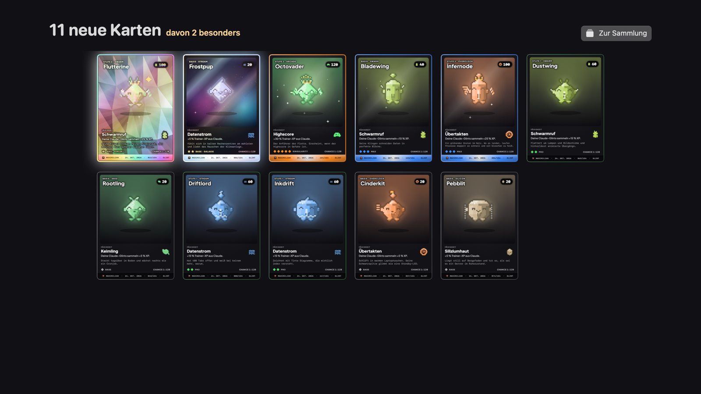
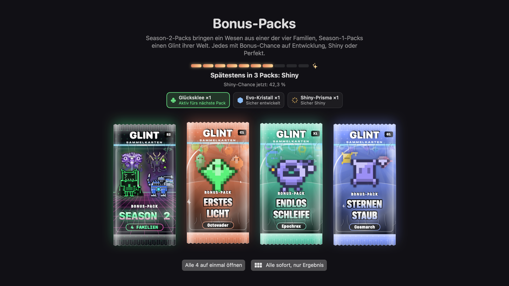

# Glint

**A small companion in your Mac's menu bar for Claude Code, Codex and Gemini CLI.**
It tells you what your AI sessions are doing, taps you when one is done or needs you, and turns every finished session into a creature to collect.

[**Download the latest Glint.dmg**](https://github.com/iamadesignerusually/glint-releases/releases/latest) · macOS 14 or later · Apple silicon and Intel

---

## What it does

**Your sessions at a glance.** Glint sits in the menu bar and shows every running session of Claude Code, Codex and Gemini CLI: working, waiting for you, or done. When one finishes, or asks a question, you get a quiet notification, so you can look away while it works.

**Your limits, before they bite.** The usage of your Claude and Codex plans sits right in the menu: the current session and the week, with a warning before you run out.

**Every session hatches a Glint.** Finished sessions bring creatures of their world: gems for Claude, loops for Codex, stars for Gemini. They have rarities from Base to Singularity, evolve as you keep working, and every now and then one comes out shiny (in one of nine finishes) or, very rarely, perfect.

**Cards and packs.** Every Glint has its own trading card, with holo foil for the rare ones and full art for perfects. Levelling up and weekly goals earn bonus packs. Open them one by one, all at once, or skip straight to the results. A pity counter makes sure a shiny turns up within ten packs.

**Yours, on every Mac.** Your collection syncs through iCloud, is backed up daily, and can be exported and imported as a file.

## Install

1. Download `Glint.dmg` from [Releases](https://github.com/iamadesignerusually/glint-releases/releases/latest).
2. Open it and drag **Glint** into **Applications**.
3. Glint is signed ad hoc for now. The first time, right-click Glint in Applications and choose **Open**.
4. Glint walks you through connecting Claude Code, Codex and Gemini CLI. It only adds small hooks that report a session's state; it never changes how your tools work.

Updates install themselves: Glint checks this page and offers new versions as they come out.

## Privacy

Glint runs on your Mac and has no server of its own. Session titles and states stay local. It talks to the outside world only to check this page for updates, to sync your collection through your own iCloud if you turn that on, and to read your plan usage from Anthropic and OpenAI with the login you already have.

## Languages

German and English, following your Mac's language.

## License & EULA

Glint is proprietary software. © 2026 Maximilian Dahl. All rights reserved.
Read the [EULA draft](EULA.md) and [license notice](LICENSE). The EULA remains
a draft for legal review; publishing or opening it does not make it binding
on existing users. Earlier valid licenses, including prior MIT grants, remain
in effect. Glint Free may be used without payment, including for work; paid
Glint Pro licensing is planned once sales begin.

Future builds include an offline reader under **Settings → About → License &
EULA…**. Existing downloads are unchanged by this documentation update.

---

Glint is a personal project by Maximilian Dahl. It is not made by, endorsed by or affiliated with Anthropic, OpenAI or Google. Claude, Codex and Gemini are trademarks of their respective owners.

<b>Auf Deutsch</b>

Glint ist ein kleiner Begleiter in der Menüleiste deines Macs für Claude Code, Codex und Gemini CLI. Er zeigt dir, was deine KI-Sessions gerade tun, meldet sich, wenn eine fertig ist oder dich braucht, und macht aus jeder fertigen Session ein Wesen zum Sammeln: mit Karten, Packs, Shinies und Perfekten.

**Installieren:** [Glint.dmg herunterladen](https://github.com/iamadesignerusually/glint-releases/releases/latest), öffnen und Glint in „Programme“ ziehen. Beim ersten Start mit Rechtsklick auf Glint → **Öffnen**. Updates kommen danach von selbst.

**Datenschutz:** Glint läuft auf deinem Mac und hat keinen eigenen Server. Nach außen geht es nur für Update-Checks, für die Synchronisation über dein eigenes iCloud (wenn du sie einschaltest) und um deine Nutzung bei Anthropic und OpenAI mit deinem bestehenden Login abzufragen.

